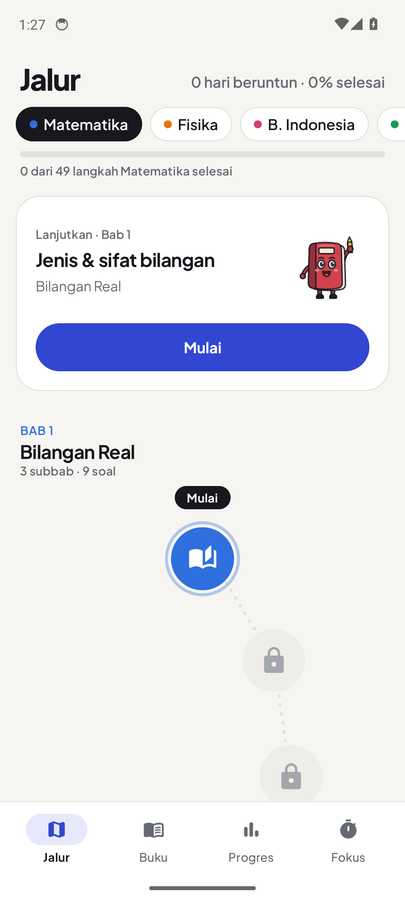
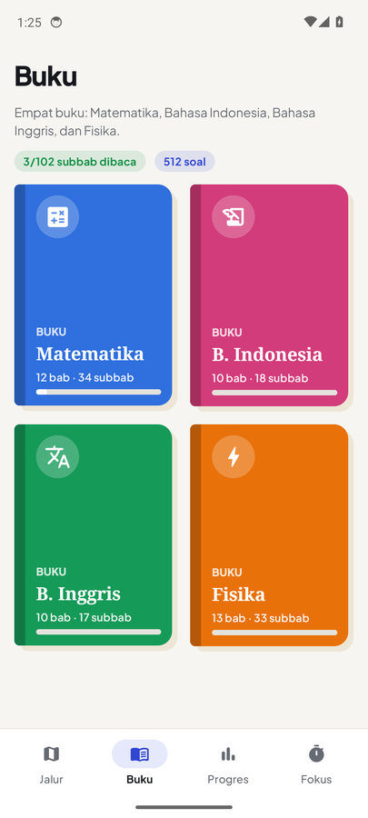
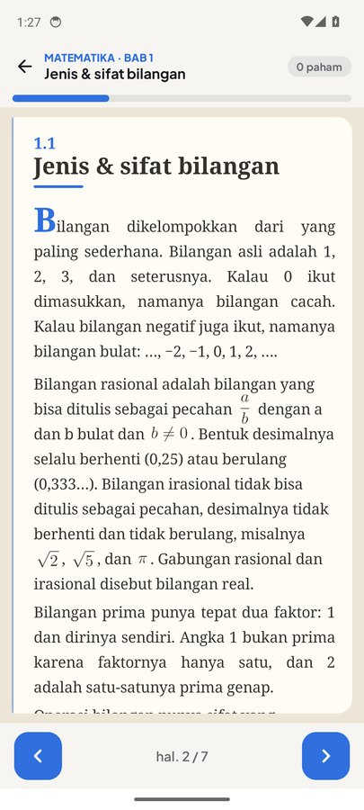
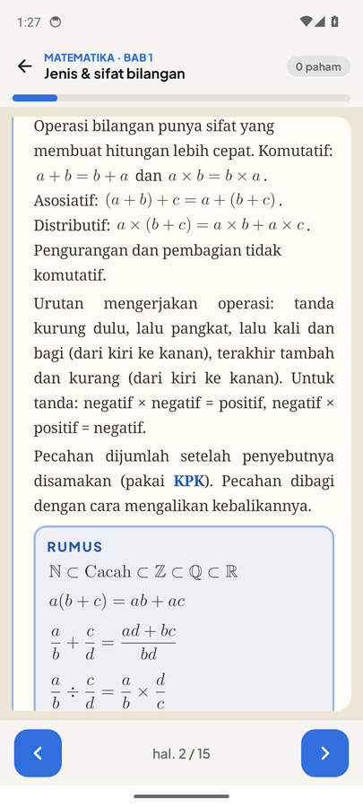
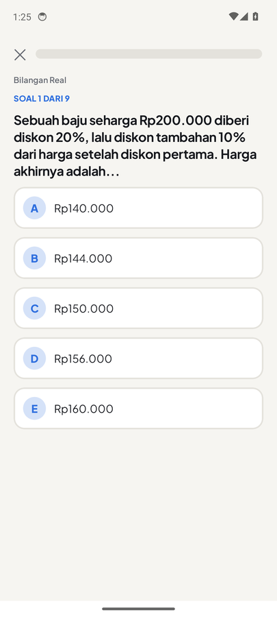
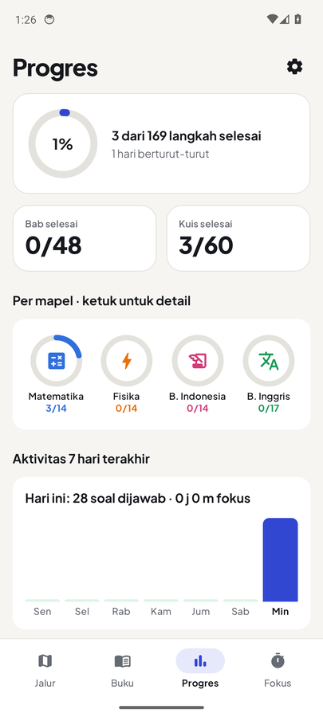

 

 

Aplikasi Android buat anak-anak belajar dengan mudah dan interaktif.

## Tampilan

<table>
  <tr>
    <td align="center"> Peta belajar</td>
    <td align="center"> Empat buku</td>
    <td align="center"> Halaman buku</td>
  </tr>
  <tr>
    <td align="center"> Kotak rumus</td>
    <td align="center"> Latihan soal</td>
    <td align="center"> Progres harian</td>
  </tr>
</table>

## Pasang

Buka [TUNTAS.apk](https://github.com/DemonPalace/TuntasAplication/releases/latest/download/TUNTAS.apk) dari HP, unduh, lalu pasang. Kalau muncul peringatan, izinkan "Instal dari sumber tidak dikenal" untuk browsernya.

## Isinya

- Empat buku, satu per mapel: Matematika 12 bab, Fisika 13 bab, B. Indonesia 10 bab, B. Inggris 10 bab. Ada contoh soal yang dibuka per langkah, daftar jebakan, dan rangkuman tiap bab.
- Rumus Matematika dan Fisika, baik di buku maupun di soal.
- Buku B. Inggris isinya bahasa Inggris seperti di tes, dengan terjemahan singkat untuk bagian yang penting.
- Peta belajar: tiap subbab satu titik, di akhir bab ada latihan. Titiknya terbuka satu per satu.
- 512 soal (PG, PG kompleks, dan PG kompleks kategori) lengkap dengan kunci dan pembahasan.
- Progres: level, hari berturut-turut, grafik harian, dan daftar soal yang masih salah.
- Sesi harian: belajar, kerjakan soal, lalu foto atau ketik ringkasannya. Selama sesi, layar tetap menyala.

## Sumber

Cakupan materi mengikuti kisi-kisi Ujian SMA 2026 dari Pusmendik. Soal sebagian dari contoh resmi, sebagian ditulis sendiri dengan acuan contoh di detikEdu, CNN Indonesia, Kompas.com, dan Blog ITERA. Daftar lengkapnya ada di tab Progres, bagian Sumber materi.

## Maskot

Tuti si Buku, gambar vektor buatan sendiri.

## Lisensi

[MIT](LICENSE)

